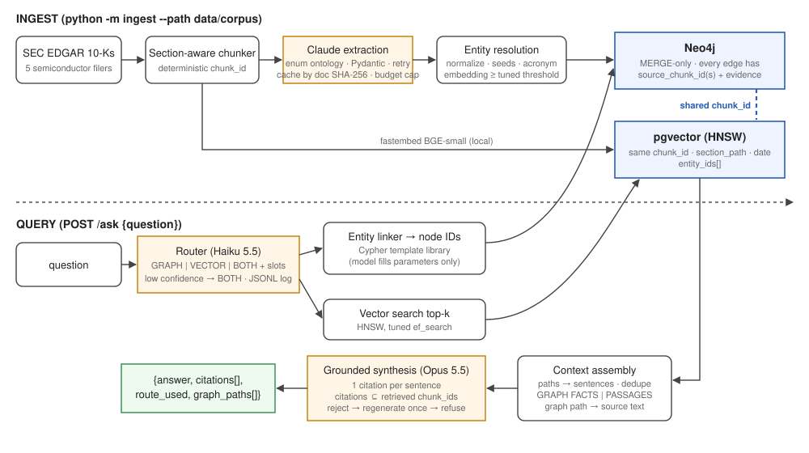

Hybrid knowledge-graph + vector RAG over SEC 10-K filings of five semiconductor companies; **headline number pending the first real benchmark run** (`python -m kgrag.eval.benchmark --write-readme` fills it in: "raised 3-hop accuracy from X% → Y% vs. vector-only at Z ms p95").

<!-- BENCHMARK:START -->
**Not yet run against the real corpus.** This table is generated by `python -m kgrag.eval.benchmark --write-readme`
after `make ingest` on the real 10-Ks with an Anthropic API key. No numbers are shown until then: the offline
dry run (fake LLM, 3 synthetic fixture files) exercises the harness but its numbers are meaningless and the
script refuses to write them here.

| Question type | n | Vector-only | Hybrid (graph + vector) | Δ |
|---|---:|---:|---:|---:|
| Single-hop | 14 | – | – | – |
| 2-hop | 14 | – | – | – |
| 3-hop | 10 | – | – | – |
| Aggregation | 10 | – | – | – |
| Refusal (out-of-scope) | 10 | – | – | – |
| Latency p50 / p95 | | – | – | |
| Cost per query | | – | – | |
<!-- BENCHMARK:END -->



## Design decisions

1. **Shared chunk ID as the only join key, enforced in code.** Chunk IDs are deterministic
   (`<ticker>-10K-<fy>:<item>:<ordinal>`); Neo4j stores them on `:Chunk` nodes and on every edge
   (`source_chunk_ids`, `evidence`), pgvector stores them as the primary key. Ingestion fails
   (`ChunkIdInvariantError`) if the two sets differ or an edge cites an unknown chunk. That buys
   graph-path → source-sentence citations and passage → graph-neighbourhood expansion for free.
   *Given up:* re-chunking (new chunk size) changes IDs, so it means a full re-ingest instead of an
   incremental update.

2. **Closed template library instead of text-to-Cypher.** Eight parameterized Cypher templates
   (`kgrag/retrieval/templates.py`); the router (Haiku 5.5) only picks a `QueryType` and fills
   enum-validated slots, and a deterministic linker turns names into node IDs. Relationship types
   are filtered with `type(r) IN $rel_types`, never interpolated. Tests assert no template contains
   a write clause or a non-`$` value. *Given up:* questions whose shape no template covers fall back
   to `NEIGHBORHOOD` + vector search. That is less capable than free-form Cypher but it can't be
   injected and the results are reproducible.

3. **Global, deterministic entity resolution over all extractions before any write.** Normalize →
   curated alias seeds → acronym rule → embedding similarity ≥ a tuned threshold, with guards
   (persons must share a surname; numbers must match, so H100 ≠ H200). Union-find + a deterministic
   canonical choice make node IDs stable across runs, which is what keeps MERGE idempotent. Every
   merge goes to `data/logs/er_merges.jsonl`. *Given up:* resolution is O(corpus), so adding one
   filing re-resolves everything (extraction itself stays cached by document SHA-256).

Also: every LLM call goes through `LLMClient`, which estimates cost before each call, aborts past
`KGRAG_BUDGET_USD`, records actual `usage` in a SQLite ledger and caches responses. The baseline
uses the same embedder, store, synthesis prompt, model and citation validator, so the benchmark
delta isolates the graph path.

## What didn't work

The real-corpus failures (router misfires, ontology drift, unresolved duplicates) get recorded
here after the first full run; `data/logs/routing.jsonl` and `er_merges.jsonl` are the raw material.
Failures found while building and testing so far:

- **Embedding similarity merged corporate siblings.** Tuning on 53 labeled name pairs with BGE-small
  showed that "Arm Holdings" vs "ARM Investments" scores 0.94 cosine. A pure threshold would have needed
  ≥ 0.94 to stop that merge, and at that level 7 true merges were missed (recall 0.77). "Intel" vs
  "Intel Foundry" carries the same risk. Fix: an embedding merge is refused when either company name has a
  non-generic token with no close spelling match in the other ("investments", "foundry"). Product names
  also drop trailing descriptors ("EPYC processors" → "epyc"). After the fix, precision is 1.0 at every
  threshold from 0.84 to 0.96; 0.91 was chosen (recall 0.97). The one remaining miss (Jensen / Jen-Hsun
  Huang) is a nickname no embedding catches, so it is an alias seed.
- **Chunk overlap duplicated section tails.** The first chunker carried the overlap paragraphs
  into a final "chunk" that held only text already in the previous chunk, so every section ended
  with a near-duplicate passage that crowded out top-k results. Fix: count only *new* paragraphs
  since the last flush (`fresh`) and never emit an overlap-only chunk.
- **"Failed chunks" counted the wrong thing.** The ingest report counted chunks with no entities
  as extraction failures, which mixes legitimately empty boilerplate with real validation
  failures. Fix: the extractor now tracks chunks that failed after retries separately, and a
  document with failures is *not* written to the document-hash cache, so the next run retries them.
- **Open-ended edge properties.** `properties: dict[str, str]` can't be expressed under structured
  outputs' `additionalProperties: false`, so the extraction schema now uses a closed
  `EdgeProperties` model and per-relationship allow-lists.
- **Pairwise ER doesn't scale.** A Python O(n²) loop over all same-type clusters was too slow;
  candidates now come from a vectorized similarity matrix above the threshold plus an acronym lookup.

---

## Quick start

```bash
cp .env.example .env            # add ANTHROPIC_API_KEY and SEC_USER_AGENT ("Name contact@email")
pip install -e ".[dev]"
docker compose up -d neo4j postgres
python -m kgrag.corpus.sec --out data/corpus --years 1     # download 5 × 10-K
python -m ingest --path data/corpus --estimate-only         # cost estimate, no API calls
python -m kgrag.eval.tune_er                                # pick KGRAG_ER_THRESHOLD
python -m ingest --path data/corpus --check-idempotent      # Phase 1+2 (second run is free)
python -m kgrag.eval.recall                                 # Phase 2 gate: recall@k >= 0.85
uvicorn kgrag.api.app:app --port 8000                       # POST /ask
python -m kgrag.eval.benchmark --write-readme               # Phase 5
```

On Windows without `make`, `scripts/kgrag.ps1 <up|fetch|estimate|ingest|recall|run|eval|test>` runs the same steps.

```bash
curl -s localhost:8000/ask -H "content-type: application/json" \
  -d '{"question": "Who is the CEO of the company that acquired VMware?"}'
# {"answer": "... [1]", "citations": [{"chunk_id": "AVGO-10K-2025:item-1:0007", "quote": "..."}],
#  "route_used": "GRAPH", "graph_paths": [["(Broadcom Inc.)-[ACQUIRED]->(VMware)", ...]]}
```

## Acceptance checks per phase

| Phase | Check | How |
|---|---|---|
| 1 | Idempotent ingest, stable node count | `python -m ingest --path data/corpus --check-idempotent` writes twice and compares counts |
| 1 | 0 duplicate canonical entities in a 20-entity spot check | automatic collision check + `data/results/er_spotcheck.md` (20 seeded random nodes) to review by hand |
| 1 | ER threshold and merge rate logged | `er.done` log line + `data/results/ingest_report.json` |
| 2 | recall@k ≥ 0.85 on ≥ 30 labeled queries | `python -m kgrag.eval.recall` (40 queries), writes `data/results/recall.json` with PASS/FAIL |
| 3 | No model-written Cypher | `tests/test_templates.py`; router output is a Pydantic enum model |
| 3 | Every routing decision logged with outcome | `data/logs/routing.jsonl` |
| 4 | Citations resolve to retrieved chunk IDs | `tests/test_citations.py`; validator in `kgrag/synthesis.py` |
| 5 | Same questions, both systems, by hop count | `python -m kgrag.eval.benchmark` |

## Ontology

Nine entity types and fourteen relationship types with allowed (source, target) signatures, hard-coded in
[kgrag/ontology.py](kgrag/ontology.py): `Company, Person, Product, Segment, Location, RegulatoryBody,
Regulation, LegalProceeding, FinancialMetric` × `SUBSIDIARY_OF, ACQUIRED, SUPPLIES, COMPETES_WITH,
PARTNERS_WITH, EMPLOYS, OFFERS, HAS_SEGMENT, OPERATES_IN, REGULATED_BY, SUBJECT_TO, PARTY_TO, REPORTS,
CUSTOMER_CONCENTRATION`. Extraction output that breaks a signature fails Pydantic validation and is retried
with the error attached.

## Labeled data (review before trusting the numbers)

- `data/eval/benchmark_questions.jsonl`: 58 questions (14 single-hop, 14 two-hop, 10 three-hop,
  10 aggregation, 10 out-of-scope). **All gold answers are `verified: false`.** They were drafted from
  general knowledge of these companies' filings and must be checked against the downloaded 10-Ks
  (fiscal years change CEOs, segments and suppliers). The benchmark report flags unverified items.
- `data/eval/recall_set.jsonl`: 40 retrieval queries labeled by content rules (company + section + phrases).
- `data/eval/er_pairs.jsonl`: 53 labeled same/different name pairs for threshold tuning.

## Layout

```
kgrag/ontology.py          enum ontology + relation signatures
kgrag/llm.py               cached, budget-checked, schema-validated Claude client
kgrag/ingest/              chunker, extraction, entity resolution, pipeline (python -m ingest)
kgrag/stores/              Neo4j + pgvector (and in-memory twins for offline tests)
kgrag/retrieval/           router, entity linker, Cypher template library
kgrag/synthesis.py         path verbalization, context assembly, citation enforcement
kgrag/rag.py               HybridRAG and the VectorOnlyRAG baseline
kgrag/api/app.py           FastAPI POST /ask
kgrag/eval/                recall@k gate, ER threshold tuning, benchmark
tests/                     35 offline tests (extraction validation, citations, ER, templates, end-to-end, API)
```

`KGRAG_OFFLINE=1` swaps in a deterministic rule-based fake LLM, hash embeddings and in-memory stores so the
whole pipeline runs with no key and no Docker. It's for tests only; its outputs are never results.
